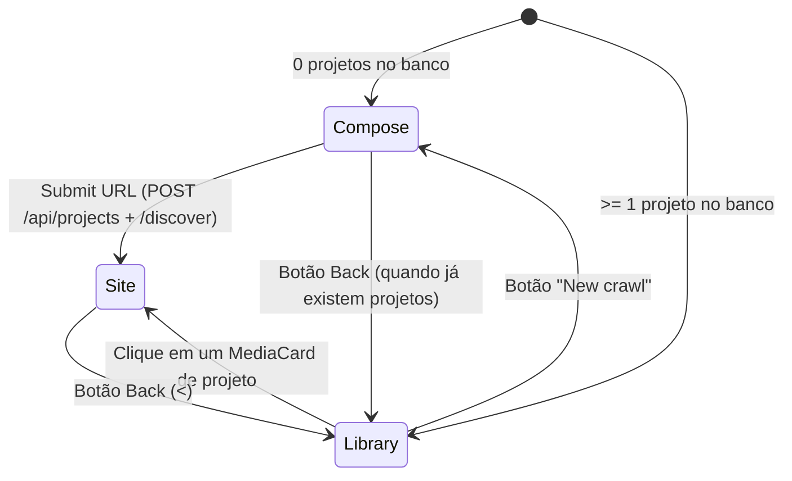

# Visual Intelligence Studio — Arquitetura de UI, Fluxos & Contratos

Este documento descreve a arquitetura de telas, a máquina de estados da interface e os contratos entre Frontend e Backend da versão consolidada do **Visual Intelligence Studio** (combinando a arquitetura de tokens/primitivos e Storybook de `cursor/figma-design-language-01c6` com os fluxos guiados, contadores de inventário, normalização de URL e exportação de arquivos `images.zip` de `feat/minimal-carbon-ui`).

---

## 1. Máquina de Estados & Navegação Principal (`frontend/src/App.tsx`)

A aplicação opera em 3 visualizações principais (`View = "compose" | "library" | "site"`) mais a rota de documentação viva (`#/docs`):

### 1.1 `ComposeScreen` (*Wireframe 1 — Start your first crawl*)
- **Layout**: Centralizado vertical e horizontalmente no canvas `#131415`, coluna máxima de `800px` com `gap-6` (`24px`).
- **Controles de Canto**:
  - Superior esquerdo (`left-20 top-20`): Ícone `back.svg` (visível apenas quando `projects.length > 0`).
  - Superior direito (`right-20 top-20`): `IconButton` de sessões autenticadas (`AuthVaultModal`).
- **Entrada de URL Inteligente (`normalizeUrlInput`)**:
  - Aceita entradas rápidas sem protocolo (`localhost:5173`, `127.0.0.1:8000` → prefixa `http://`; `curso.dev` → prefixa `https://`), evitando bloqueios de validação nativa do navegador.
- **Sessão Autenticada Ativa**:
  - Quando uma sessão do cofre está selecionada, um `Chip` (`kind="filled"`) com o nome da sessão e botão de dispensar (`onDismiss`) aparece `24px` abaixo da barra de URL.

### 1.2 `LibraryScreen` (*Wireframe 4 — My crawls*)
- **Layout**: `.page-frame` (`max-w-[1440px]`, padding `80px 80px 40px`, gap `40px`).
- **Cabeçalho**:
  - Esquerda: Título `My crawls` (`text-display font-bold`).
  - Direita (`gap-2`): `IconButton` de sessões autenticadas, botão primário `New crawl` e `SearchField` (`411px` em desktop).
- **Grade de Projetos**:
  - 3 colunas (`grid-cols-1 md:grid-cols-2 xl:grid-cols-3 gap-6`) de `MediaCard`.
  - **Metadados Inteligentes**: Quando o crawl está concluído e possui capturas, exibe `["N screens", "M components", "Date"]`; caso contrário, exibe `[hostname, statusLabel, Date]`.

### 1.3 `Site View` (*Wireframe 3 — Detalhe do Site & Ciclo de Crawl*)
Dentro do `.page-frame`, a tela de detalhe do site guia o usuário pelas etapas do crawl sem trocar de contexto:
1. **Navegação**: Ícone `back.svg` no topo para retornar a `My crawls`.
2. **Cabeçalho do Site**:
   - Esquerda: Nome do site (`text-display font-bold`) e resumo dinâmico (`text-body text-muted`) combinando URL base e contagens extraídas (`https://site.com  12 screens  24 components  19 tokens`).
   - Direita (`gap-2`):
     - `IconButton` (`refresh.svg`) → Abre o modal de recaptura seletiva de rotas (`Recapture pages`).
     - `Button variant="secondary"` (`Export design.md`) → Abre o `ExportDrawer` com todos os artefatos (`design.md`, `images.zip`, `tokens.json`, `CONTEXT.md`, `llms.txt`, `gallery.html`).
     - `Button variant="primary"` (`Export images`) → Dispara o download direto do arquivo `images.zip` contendo todas as imagens capturadas.
3. **Progresso ao Vivo (`LiveCrawlProgress.tsx`)**:
   - Exibido enquanto `runStatus` é `discovering`, `capturing` ou `failed` (atualizado em tempo real via WebSocket `/ws/runs/{run_id}`).
4. **Revisão de Rotas Descobertas (`DiscoveryReview.tsx`)**:
   - Exibida quando `runStatus === "review_pending"`.
   - Permite alternar chips de configuração da matriz de captura (`Desktop`, `Mobile`, `Tablet`, `Ultrawide`, `Light`, `Dark`, `Above the fold`), selecionar/desmarcar todos os padrões e expandir grupos de rotas dinâmicas (`/blog/:slug`).
5. **Galeria & Inspetores (`StudioGallery.tsx`)**:
   - Exibida durante `capturing` (streaming progressivo a cada captura concluída) e quando `completed`.

---

## 2. Sistema de Filtros & Navegação de Conteúdo (`StudioGallery.tsx`)

A barra de controles do `StudioGallery` resolve o equilíbrio entre **minimalismo visual** e **descoberta das capacidades da plataforma**:

- **Esquerda — Popover `Filter` + Chips de Filtros Ativos**:
  - O botão `Chip kind="outline" label="Filter"` abre um menu flutuante (`w-[280px] rounded-card border-line bg-overlay-surface p-6`) com filtros de `Content`, `Viewport`, `Theme`, `Capture` (`Full page` / `Above the fold`) e categoria de seção/componente.
  - Todo filtro que difere do padrão projeta automaticamente um `Chip kind="filled"` ao lado do botão `Filter` (ex.: `Desktop ⓧ`, `Light ⓧ`). Clicar no ícone `dismiss.svg` remove aquele filtro.
- **Direita — Pílulas Guiadas de Conteúdo com Contadores**:
  - Exibe as categorias extraídas (`Screens`, `Sections`, `Components`, `Modals` [quando > 0], `Tokens`) com seus respectivos contadores em `text-label text-muted`, permitindo alternar entre as visões em 1 clique.
- **Lightbox & Inspetores**:
  - **Lightbox de Capturas**: Navegação por setas (`←` / `→`), zoom por teclado (`+` / `-` / `0`), zoom por `Ctrl + Scroll`, clique direto na imagem para alternar `100% Fit` ↔ `150% Scroll`, botão rápido de recaptura da rota e download do PNG.
  - **Modal de Componente**: Exibe o recorte do componente sobre fundo `bg-sunken`, frequência de uso, propriedades CSS computadas (`font-mono`) e rotas onde ocorre.
  - **Inspetor de Tokens (`TokenInspector.tsx`)**: Grade de cores, escala tipográfica, raios de borda e sombras com cópia em 1 clique (`Copied`) para a área de transferência.

---

## 3. Contratos de API Backend (`backend/app/main.py`)

| Método & Rota | Descrição | Payload / Retorno Principal |
| :--- | :--- | :--- |
| `GET /api/projects` | Lista projetos com o último run e contadores agregados | `[{ id, name, base_url, preview_url, latest_run: { id, status, screens_count, sections_count, components_count, tokens_count, routes_count } }]` |
| `GET /api/crawls` | Lista histórico completo de runs com contadores e preview | `[{ run_id, project_id, site_name, base_url, status, screens_count, components_count, tokens_count, preview_url }]` |
| `POST /api/projects` | Cria novo projeto para um domínio/URL | `{ name, base_url, auth_profile_id }` |
| `POST /api/projects/{id}/discover` | Inicia descoberta híbrida SPA/DOM em background | `{ run_id, status: "discovering" }` |
| `GET /api/runs/{id}/routes` | Lista rotas agrupadas por padrão dinâmico | `{ run_id, total_routes, patterns: [...] }` |
| `POST /api/runs/{id}/capture` | Inicia pipeline multi-viewport e multi-tema | `{ viewports, themes, include_fold }` |
| `POST /api/runs/{id}/recapture` | Recaptura rotas específicas mantendo cache-busting | `{ route_paths, viewports?, themes?, include_fold? }` |
| `GET /api/runs/{id}/gallery` | Retorna inventário completo da galeria com `?v=<mtime>` | `{ run_id, project, screens, sections, modals, components, tokens }` |
| `GET /api/runs/{id}/exports/{file}` | Baixa artefatos gerados ou gera `images.zip` sob demanda | Suporta `DESIGN_SYSTEM.md`, `images.zip`, `tokens.json`, `CONTEXT.md`, `llms.txt`, `gallery.html` |
| `WS /ws/runs/{id}` | Stream de progresso e eventos `asset_updated` em tempo real | `{ run_id, text, percent, status, asset_updated }` |

---

## 4. Checklist para Evolução da Interface (Agentes & Devs)

1. **Nunca use cores fora de `tokens.css`**: Use apenas as classes semânticas do Tailwind (`bg-canvas`, `bg-sunken`, `bg-surface`, `bg-chip`, `bg-media`, `bg-overlay-surface`, `text-white`, `text-muted`, `text-subtle`, `text-ink`, `border-line`).
2. **Reutilize `frontend/src/components/ui/`**: Antes de criar um `<button>`, `<input>` ou modal customizado, utilize `Button`, `IconButton`, `Chip`, `TextField`, `SearchField`, `MediaCard` e `Modal`.
3. **Mantenha o Build Sincronizado**: O FastAPI serve os arquivos estáticos de `frontend/dist` na porta `:8000`. Sempre execute `cd frontend && npm run build` após alterar qualquer arquivo em `frontend/src/`.
4. **Atualize o Catálogo `#/docs`**: Se um novo componente primitivo for adicionado em `frontend/src/components/ui/`, registre sua história em `frontend/src/components/docs/stories.tsx`.
